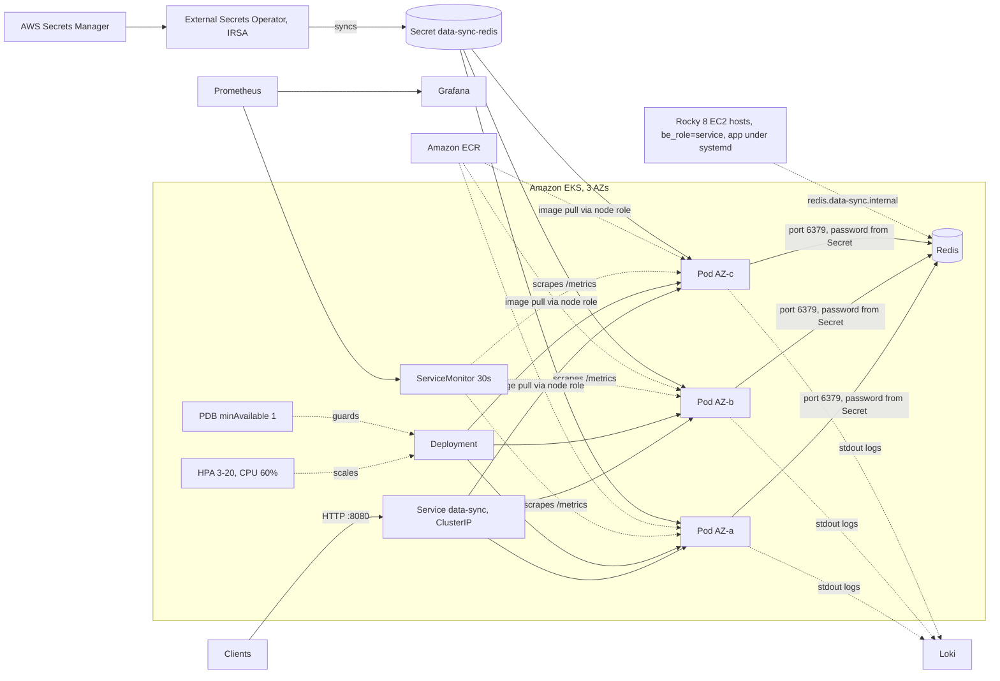

# Architecture, NFRs and maintaining the repo

## Overview



The same application is delivered two ways:

- Kubernetes: `helm/charts/data-sync`, optionally through the overlay in `standard/data-sync/production`. Deploy with `helm upgrade --install` or `kubectl apply -k`.
- EC2: `ansible/roles/be-data-sync` through `playbooks/playbook-data-sync.yml`, for hosts that aren't in Kubernetes yet.

Both use the same settings (`APP_ENV`, `REDIS_*`, `LOG_LEVEL`, `WORKERS`, `MAX_CONNECTIONS`).

### GCP to AWS mapping

The brief is written for GCP; this repo targets AWS, which it allows.

| Concern | GCP | AWS |
| --- | --- | --- |
| Kubernetes | GKE | EKS |
| VMs | GCE | EC2 |
| Ansible inventory | `google.cloud.gcp_compute` | `amazon.aws.aws_ec2` (`ansible/inventory.aws_ec2.yml`) |
| Secrets | Secret Manager | Secrets Manager, synced by External Secrets |
| Pod to cloud identity | Workload Identity | IRSA or EKS Pod Identity |
| Registry | Artifact Registry | ECR |
| Dedicated nodes | node pool | managed node group or Karpenter NodePool |
| Managed Redis | Memorystore | ElastiCache |

The zone label, `topology.kubernetes.io/zone`, is the same, so the overlay doesn't change.

## Layout

```
data-sync-deploy/
├── helm/charts/data-sync/        chart, values files, chart README
├── standard/data-sync/
│   ├── base/                     generated: helm template output (production values)
│   └── production/               kustomization, patches, SecretStore and ExternalSecret
├── ansible/
│   ├── roles/be-data-sync/
│   ├── playbooks/playbook-data-sync.yml
│   ├── group_vars/service.yml
│   ├── inventory.yml             static example
│   └── inventory.aws_ec2.yml     EC2 tag-based inventory
├── scripts/                      render-base.sh, secret-checksum.sh
├── docs/                         DESIGN.md, DECISIONS.md, ARCHITECTURE.md
├── Makefile
└── .github/workflows/ci.yml
```

## Non-functional requirements

| Requirement | How it's met |
| --- | --- |
| Availability through drains, upgrades and an AZ loss | PDB, `maxUnavailable: 0`, zone spread, at least 3 replicas in production |
| Handling a 2,000 req/s burst | HPA 3-20 with fast scale-up; KEDA as the next step (`DESIGN.md`) |
| Stable latency | requests = limits (Guaranteed QoS); isolation plan in `DESIGN.md` |
| Security | non-root, read-only root filesystem, no capabilities, no service account token, external Secret in production, Vault and `no_log` on VMs |
| Observability | ServiceMonitor every 30 s, logs to Loki, `LOG_LEVEL` per environment |
| Easy deploy and rollback | `helm upgrade --atomic`, `kubectl rollout undo`, Makefile targets |
| Reproducible environments | environments differ only by values files; the rendered base is checked in CI |
| Safe rollouts | `serial: 1` on VMs, `--atomic` on Helm, startup and readiness probes |

The numbers I'd tune to are a guess: 99.9% availability, p95 under 200 ms, errors under 0.1%.

## Working in the repo

### Making a change
1. Branch, then edit `templates/` or `values*.yaml`.
2. Bump `version` in `Chart.yaml` for any chart change (and `appVersion` for a new app release).
3. Run `make render` and commit the regenerated base in the same PR.
4. Run `make all` (needs `helm`, `kubectl`, `ansible-core` and `ansible-lint`).
5. CI runs the same checks, and `make check-render` fails if step 3 was skipped.
6. Deploy to staging, verify, then production.

### Releasing a new version
- Helm: set `image.tag` or change `appVersion`.
- Kustomize: edit `newTag` under `images:` in `standard/data-sync/production/kustomization.yaml`.
- EC2: set `data_sync_repo_version` to a tag or SHA, never `main`.

### Rotating the Redis password
Follow `DESIGN.md`, section 3. In the repo: `make secret-checksum` (it waits for External Secrets to sync and then writes the new AWS version ID), commit `patch-secret-checksum.yaml`, apply. On EC2, update the vaulted `data_sync_redis_password` and run `--tags deploy`.

### Conventions
- The overlay patches the Deployment named `data-sync`, so the Helm release has to be called `data-sync`.
- The selector labels in `_helpers.tpl` can't change once a Deployment exists.
- Ansible variables start with `data_sync_`, and new roles follow `be-{service}`.
- Values files hold differences only; shared defaults go in `values.yaml`.
- Never commit secrets.

### Housekeeping
- At each EKS minor upgrade, check API versions (`autoscaling/v2` and `policy/v1` need Kubernetes 1.23+).
- Python 3.9 is end of life (Oct 2025); move the role to a newer AppStream module.
- Each quarter, rerun the load test and adjust the CPU request, since it is the HPA's 100% mark.
- Rotate the Redis password every 90 days, with a calendar alert at day 80.

### Troubleshooting
| Symptom | Likely cause | What to check |
| --- | --- | --- |
| Install fails with `no matches for kind "ServiceMonitor"` | Operator CRDs missing | install kube-prometheus-stack or use `--set serviceMonitor.enabled=false` |
| Target missing in Prometheus | label mismatch | `serviceMonitor.labels.release` against Prometheus' `serviceMonitorSelector` |
| Pods Pending after a production apply | an AZ has no capacity (hard spread) | `kubectl describe pod`; add capacity or use `ScheduleAnyway` |
| `helm upgrade` resets the replica count | HPA on and `replicas` set somewhere | the chart omits `replicas` when the HPA is on; check custom patches |
| Node drain hangs | PDB with a single replica | scale to 2+ or disable the PDB temporarily |
| `check-render` fails in CI | stale base | run `make render` and commit |
