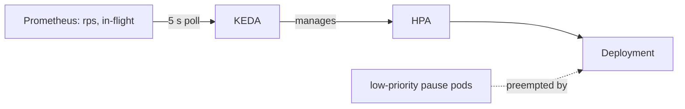

# data-sync design answers

I'm assuming EKS across three AZs, the Prometheus Operator, a burst of about 2,000 req/s, and Redis 6+ with ACLs (in-cluster or ElastiCache).

## 1. Getting scale-out under 20 seconds

The 90 seconds is several delays added together: metrics-server lag (15-30 s), the HPA sync (15 s), EC2 node provisioning when there's no spare room (40-60 s with Cluster Autoscaler), the image pull, app start and readiness. CPU is also a late signal. It only climbs once requests are already queuing.

What I would do, cheapest first:

1. Tune the HPA. The chart already does this: no scale-up stabilisation, up to +100% or +4 pods every 15 s, CPU target at 60%, and a 5-minute scale-down window so we don't flap and cause Redis reconnect storms.
2. Make pods start faster. Keep the image small and pre-pull it on nodes (bake it into the AMI), and poll the startup probe every 2 s.
3. Scale on leading signals with KEDA, polling every 5 s: requests per second per pod, in-flight requests and p95 latency. Keep CPU as a second trigger and set KEDA's `fallback` so a Prometheus outage can't freeze scaling. KEDA creates the HPA itself, so the Deployment must not also have a hand-written one.
4. Keep spare capacity. Set `minReplicas` for a typical burst and run low-priority "balloon" pods that burst pods preempt immediately. This removes EC2 provisioning time, the biggest item. Karpenter also launches nodes faster than Cluster Autoscaler. Cron triggers cover peaks we can predict.
5. Protect Redis. `MAX_CONNECTIONS` times `maxReplicas` has to stay under Redis `maxclients`. Use client timeouts, and return 429 instead of queuing without limit.

Rough budget: 5 s KEDA poll, 2 s HPA action, about 10 s to start on a warm node, so roughly 17 s.

The costs: spare capacity is paid for all the time, KEDA is one more component and puts Prometheus in the scaling path, aggressive scale-up can overshoot (fine, since scale-down is slow), and the per-pod rps target needs a load test to set properly.

## 2. Isolating data-sync from noisy neighbours

I'd go in layers and only move to the next when the previous one isn't enough.

| Layer | Primitive | What it gives us |
| --- | --- | --- |
| CPU | requests = limits (Guaranteed QoS), static CPU manager if available | dedicated cores, last to be evicted |
| Priority | high `PriorityClass` for data-sync | wins scheduling and preemption |
| Separation | podAntiAffinity against `app=clickhouse` | never on the same node |
| Fairness | `ResourceQuota` and `LimitRange` per namespace | no namespace can overcommit the pool |
| Hard isolation | dedicated node group: taint `workload=data-sync:NoSchedule`, matching toleration, required `nodeAffinity` on `eks.amazonaws.com/nodegroup` | only data-sync runs there |

A taint keeps other pods out and affinity pulls ours in, so the dedicated group needs both. A quota only caps a namespace's total; it does nothing at node level.

I'd reach for a dedicated node group once latency still breaks after QoS and anti-affinity. Kubernetes doesn't isolate L3 cache, memory bandwidth, disk or network, and ClickHouse hammers all four. I wouldn't use priority to preempt ClickHouse, since it's stateful and costly to evict. It should get its own group too, on storage-optimised instances. The cost is poorer bin-packing, so give each group a small minimum size and let it autoscale.

## 3. Rotating REDIS_PASSWORD without downtime

The idea is that old and new passwords are both valid during the switch, so old and new pods can run side by side.

1. Create a new version of the secret in AWS Secrets Manager.
2. Tell Redis to accept both: `ACL SETUSER default >NEW` (Redis 6+). On ElastiCache a user can hold two passwords: `aws elasticache modify-user --passwords OLD NEW`.
3. Let External Secrets (using an IRSA role scoped to this one secret) update the `data-sync-redis` Secret. Environment variables aren't reloaded in running pods, so a restart is needed. The alternative is mounting the secret as a file and re-reading it on auth failure, but that needs an app change.
4. Roll the pods by running `make secret-checksum` and applying. After the sync it sets `SECRET_CHECKSUM` to the new AWS version ID (not a hash, so nothing leaks), which triggers a rolling update with `maxUnavailable: 0`, a surge, and the PDB, so pods are replaced in batches.
5. Make readiness fail on bad credentials. `/health` doesn't touch Redis today, so I'd add a readiness check that sends `PING`. A wrong password then stalls the rollout while the old pods keep serving.
6. Verify: `rollout status` completes, every pod has the new checksum, Redis `ACL LOG` shows no auth failures, error rate and p99 stay flat in Grafana, and `CLIENT LIST` shows nothing left from old pods.
7. After a soak period, drop the old password (`ACL SETUSER default <OLD`, or `modify-user --passwords NEW` on ElastiCache) and verify again.

Until step 7 rollback is easy, because the old password still works: `kubectl rollout undo`. On EC2 hosts the equivalent is `ansible-playbook --tags deploy` with the new vaulted password, which already goes one host at a time. For the 90-day schedule, a scheduled job that alerts at day 80 beats relying on memory.
